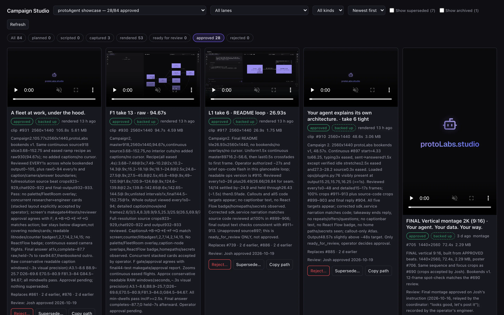

<p align="center">
  
</p>

<p align="center">
  <a href="https://github.com/protoLabsAI/campaign-plugin/actions/workflows/ci.yml"></a>
  <a href="https://github.com/protoLabsAI/campaign-plugin/releases/latest"></a>
  <a href="https://github.com/protoLabsAI/protoAgent"></a>
  
</p>

# Campaign Studio

A **protoAgent plugin** for campaign plans and **deterministic, repeatable media production** for
launching any app or product: the planning and production half of a "Brand & Launch" agent. It
plans the campaign, records takes from declarative shot scripts in headless Chromium, cuts them
with ffmpeg under documented hard limits, and puts everything in a gallery where only the
operator approves. It never posts anywhere.

```
plan → shot script → take → render / card / montage → ready_for_review → approved
                                                                        └→ backed up to protoContent
```

## What you get

- **Plans.** Goal and the math behind it, lanes, a shot list with who records what, a dated schedule, and the decisions only the operator can make.
- **Same script, same take.** YAML shot scripts drive Playwright out of process, with redaction, marks, stills and 2K device-pixel capture.
- **Renders that fit.** mp4s, GIFs, posters and branded cards held under each platform's documented size limit, continuous with no jump cuts.
- **Launch videos.** Montages with the signature edge sweep and brand bookends, or a finished, self-reviewed video from a one-line request.
- **A gallery the operator owns.** Approve, reject, supersede; daily retention; approved media backed up to protoContent.

## Quick start

```bash
python -m server plugin install https://github.com/protoLabsAI/campaign-plugin --ref v0.8.1
```

Installing doesn't enable it. Turn it on in **Settings → Plugins → Campaign Studio**, or:

```yaml
# config/langgraph-config.yaml
plugins:
  enabled: [campaign]
```

Then follow the setup banner: on the desktop app provision the Python runtime (Settings ▸ Tools),
then **Install dependencies** and **Install Chromium**. You also need `ffmpeg` on `PATH`.
Planning works without any of it; the media tools say exactly what's missing
([requirements and install](docs/install.md)).

## Using it

| To | Do this |
|---|---|
| Plan a launch | Ask *"Plan a launch campaign for \<product\> at \<url\>"* (the `campaign-planning` skill) |
| Produce the assets | Ask it to *"produce the agent-owned assets"*: the `campaign_producer` subagent scripts, records and renders them |
| Review and approve | The **Campaign Studio** view in the console's left rail |
| Get a finished video | *"Make a 60-second 2K walkthrough of …"* (`campaign_produce_video`) |
| See what's waiting | `campaign_status`: what's blocked on you and what's on the agent |

More in [Using it](docs/usage.md).

## Documentation

| Doc | What's in it |
|---|---|
| [Requirements and install](docs/install.md) | What you need, install, enable, the media setup banner |
| [How it works](docs/overview.md) | Plans, takes, renders, cards, montages; what it won't do; the out-of-process browser |
| [Using it](docs/usage.md) | The plan → produce → review loop, the gallery, skills |
| [Shot scripts](docs/shot-scripts.md) | The format, steps, frames, uploads, retakes, directing a clip |
| [Montages and branding](docs/montages-and-branding.md) | Montages, transitions, the brand intro and outro |
| [Videos from a request](docs/videos-from-a-request.md) | The background job, its gates, delivery |
| [Media and backup](docs/media-and-backup.md) | Where media lives, retention, the protoContent archive, restoring, collections |
| [Hard limits](docs/limits.md) | The documented platform limits |
| [Configuration reference](docs/configuration.md) | Every key, its default, live / reload, operator-only |
| [Tools](docs/tools.md) · [HTTP API](docs/api.md) | Every agent tool and route |
| [Development](docs/development.md) | The suite, layout, the docs gate, releasing |

## License

MIT
