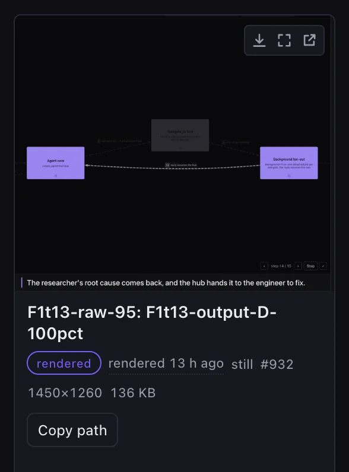
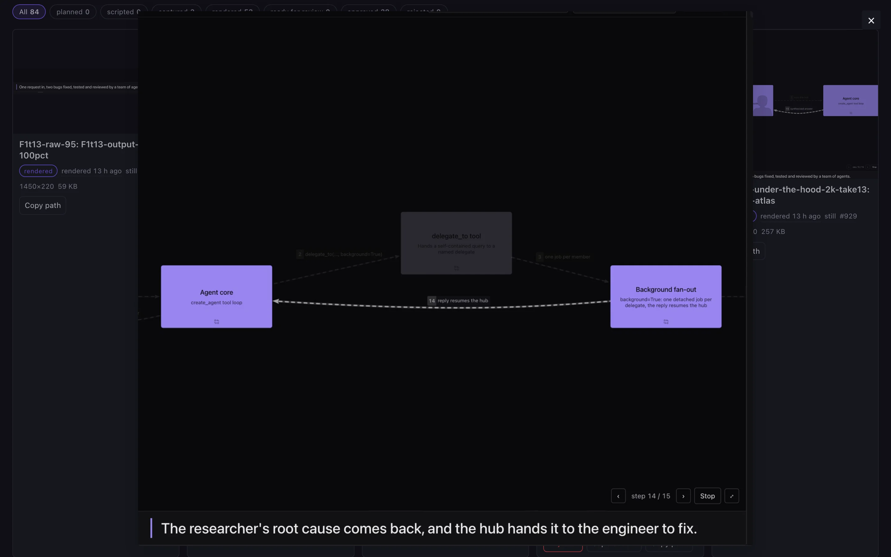

# Using it

The day-to-day loop: plan, produce, review. Every tool is in the [tools reference](tools.md);
this page is the tour.

## The loop

1. **Plan.** Ask *"Plan a launch campaign for <product> at <url>"*. The `campaign-planning`
   skill turns the brief into a plan (`campaign_create`, `campaign_lane`, `campaign_asset_add`,
   `campaign_milestone`, `campaign_decision`). `campaign_status` shows what is blocked on the
   operator and what is on the agent.
2. **Produce.** Ask it to *"produce the agent-owned assets"*. That goes to the
   `campaign_producer` subagent, which scripts and records takes ([Shot scripts](shot-scripts.md)),
   renders cuts and cards, and self-checks each one (the `asset-review` skill) before marking it
   `ready_for_review`. For a launch video see [Montages and branding](montages-and-branding.md);
   for a one-line request like "make a 60-second 2K walkthrough" see
   [Videos from a request](videos-from-a-request.md).
3. **Review.** Open the **Campaign Studio** rail view and approve or reject. Only the operator
   approves: there is no agent tool for it.
4. **Keep.** Approved media is never pruned and, with the archive on, is backed up to
   protoContent. See [Media and backup](media-and-backup.md).

## The gallery

  

- **Gallery** — one console view, for browsing: every clip/GIF/still/card of a campaign,
  playable, with status, size, dimensions, and the operator-only **Approve / Reject** buttons.
  Superseded takes are hidden (a **Show superseded** toggle brings them back, dimmed); an
  approved asset has a **Supersede…** button, the only way it can be retired.
  An image has the chat's hover buttons: **Download**, **View fullscreen** and **Open in new
  tab**. The last one opens a 15-minute signed link to that one file
  (`/plugins/campaign/open/<id>?exp=…&sig=…`, public, minted only by the gated
  `POST /api/plugins/campaign/assets/<id>/open-link`). In the desktop app it opens in the system
  browser. A re-render or a deleted `<data_dir>/open-link.key` revokes outstanding links.
  Every card says **when the clip was made** ("12 min ago"; hover for the local date and time):
  the shot/render folder stamp (`YYYYMMDD-HHMMSS`, UTC), else the file's mtime — a render also
  names its source take's time. Sorted **newest first** by default (oldest first / asset # too),
  and the retake chain reads by time ("Superseded by #42 · 3 min later", "Replaces #41 · …").
  The assets API carries `created_at` / `updated_at` (the row), `made_at` + `made_from`
  (`stamp` | `mtime`) and `take_at`.

  

**View fullscreen** opens the chat's image viewer over the gallery:

  

The gallery is a plugin view at `/plugins/campaign/view`; its data comes from the gated routes in
the [HTTP API reference](api.md).

## Skills and the producer

Five skills ship in `skills/`: `campaign-planning` (a brief → a plan), `shot-scripting` (robust
shot scripts), `asset-review` (the self-check before `ready_for_review`), `montage-editing`
(plan, storyboard and cut a montage) and `produce-walkthrough-video` (a finished video from a
plain request). The `campaign_producer` subagent and its tool allowlist are described in the
[tools reference](tools.md#the-producer-subagent).

### Keeping the agent's context small

Production is noisy: a take, a look, a fix, a re-take, a render, another look. Done in the
operator's chat thread, every one of those replies stays in its context — a night of
brandLaunch takes grew one thread from 64k to 478k prompt tokens (issue #48). The skills say
how to keep it small, and the tools are built for it:

- **One asset per `task(campaign_producer)`.** The lead thread hands the producer one asset id
  and gets back ids and paths; the take/look/fix loop lives and ends in the subagent's context.
- **Save a script once, iterate by id.** `campaign_script_save` once, then
  `campaign_shoot(script_id=…, overrides=…)`: a step number fixes a step, a top-level key
  (`base_url`, `color_scheme`) points the same script at another sandbox or theme. Resending the
  YAML for a one-line change is what filled the thread.
- **One 12-frame contact sheet per review pass** (`campaign_view(…, frames=12)` or one
  `every_s` page), plus `around=` each cut — not page after page of 1-second sheets.
- **A fresh session per clip.** `campaign_sandbox_reset` clears the sandbox console the script
  records (its chats, artifacts, goals) before the next take, instead of a hand-written
  `browser_eval` snippet.
- **Short replies.** `campaign_shoot` / `campaign_render` / `campaign_video_status` reply with
  ids, one directory, the numbers and the next call; the full logs stay on the asset
  (`campaign_asset`) or the job (`verbose=true`).
